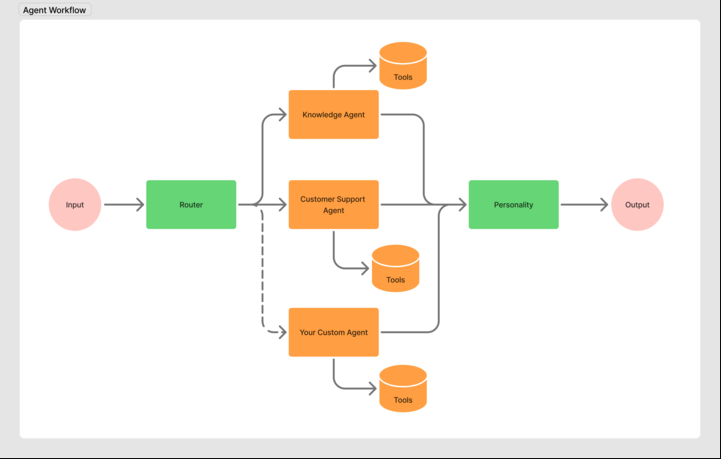

# Getnet Multi-Agent Support

A FastAPI service that answers Getnet merchant messages with four cooperating agents: a **Router** that plans, a **Knowledge** agent (RAG over the Getnet websites, or Google Search grounding for general facts), a **Customer Support** agent (two function-calling tools over the merchant's own data) and a **Human Escalation** agent (tickets that an operator claims and resolves). A bounded supervisor loop runs the plan, a critic revises it when observations call for it, a synthesis step merges the parts, and a Personality step applies the brand voice under a code-checked fact lock. All model calls use Gemini through the `google-genai` SDK behind one metered wrapper. Orchestration is plain Python with direct function calls and no agent framework.

Design source of truth: [`specs/001-multi-agent-support/`](specs/001-multi-agent-support/spec.md) (spec, plan, contracts) and the [constitution](.specify/memory/constitution.md). Security analysis: [`docs/threat-model.md`](docs/threat-model.md). The challenge statement is in [`docs/challenge.md`](docs/challenge.md).

## Quick start

Requirements: Docker with Compose. A Gemini API key is needed for live mode only.

```bash
cp .env.example .env
# fill GEMINI_API_KEY, JWT_SECRET and PSEUDONYM_KEY (for example: openssl rand -hex 32)

docker compose up --build --wait      # first start ingests the knowledge base; readiness waits

TOKEN=$(docker compose exec -T api python -m getnet_multi_agent.cli token --sub cliente1988 --role merchant)

curl -s http://127.0.0.1:8000/chat \
  -H "Authorization: Bearer $TOKEN" \
  -H 'Content-Type: application/json' \
  -d '{"message": "When will the money from yesterday'"'"'s sales be deposited?", "user_id": "cliente1988"}'
```

Response shape (abbreviated, see [`contracts/http-api.md`](specs/001-multi-agent-support/contracts/http-api.md)):

```json
{
  "answer": "...",
  "status": "answered",
  "refusal_reason": null,
  "route": "support",
  "sources": [],
  "ticket_id": null,
  "conversation_id": "uuid",
  "request_id": "uuid",
  "trace": {
    "plan_revisions": [],
    "critic_notes": ["..."],
    "observations": [{"step_id": "s1", "agent": "support", "status": "answered", "evidence": [], "unanswered": [], "usage": ["..."]}],
    "total": {"tokens": 0, "cost_usd": 0.0, "latency_ms": 0}
  }
}
```

`status` is `answered`, `awaiting_human` or `refused`. `route` is `refusal`, `escalation`, or the executed answering steps joined by `>` (`support`, `knowledge:rag`, `knowledge:web`, for example `support>knowledge:rag`).

Plain Docker (no Compose):

```bash
docker build -t getnet-multi-agent:dev . \
  && docker run --env-file .env -p 127.0.0.1:8000:8000 -v getnet-state:/app/data/state getnet-multi-agent:dev
```

Stub mode (no API key, deterministic outputs and hash embeddings):

```bash
LLM_MODE=stub docker compose up --build --wait
```

Stop with `docker compose down` (add `-v` to delete the state volume).

## Configuration

Secrets and settings come from `.env` (never committed; `.env.example` is the template). The container receives them through `env_file`; a process environment variable overrides `.env`.

| Variable | Meaning |
|---|---|
| `GEMINI_API_KEY` | Gemini API key (live mode). Google Search grounding needs a paid-tier key. |
| `GEMINI_MODEL` | Model for Knowledge, Support and synthesis. |
| `GEMINI_MODEL_THINKING` | Thinking level for `GEMINI_MODEL` (`low`). |
| `GEMINI_ROUTER_MODEL` | Lite model for router, critic, summary and Personality. |
| `GEMINI_ROUTER_THINKING` | Thinking level for the lite model (`minimal`). |
| `GEMINI_EMBEDDING_MODEL` | Embedding model (768-d output). |
| `GEMINI_JUDGE_MODEL` | Eval judge model; never on the request path. |
| `GEMINI_JUDGE_THINKING` | Judge thinking level (`high`). |
| `PRICE_FLASH_INPUT_PER_M`, `PRICE_FLASH_OUTPUT_PER_M` | USD per million tokens for `GEMINI_MODEL` and the judge. |
| `PRICE_LITE_INPUT_PER_M`, `PRICE_LITE_OUTPUT_PER_M` | USD per million tokens for `GEMINI_ROUTER_MODEL`. |
| `PRICE_EMBEDDING_PER_M` | USD per million embedding input tokens. |
| `PRICE_SEARCH_PER_1K` | USD per 1,000 Google Search queries (counted from grounding metadata). |
| `JWT_SECRET` | HS256 signing secret. Required; used only by the CLI to issue tokens and by the API to verify them. |
| `JWT_ISSUER`, `JWT_AUDIENCE` | Required `iss` and `aud` claims. |
| `PSEUDONYM_KEY` | HMAC key that turns user ids into pseudonyms for logs, prompts and the audit trail. |
| `MAX_MESSAGE_CHARS` | Message length limit (2000); longer input is refused by code. |
| `RAG_TOP_K` | Chunks returned by retrieval (6). |
| `RAG_MAX_PAGES` | Page cap for the `refresh` crawler (80). |
| `RAG_MIN_SIMILARITY` | Score threshold for retrieved chunks (0.62). |
| `MAX_TOOL_ITERATIONS` | Function-calling turns per Support step (3). |
| `MAX_SUPERVISOR_ITERATIONS` | Supervisor loop cap (3). |
| `REQUEST_TOKEN_BUDGET` | Token budget per request (30000); exceeding it escalates. |

Process-environment settings that are not in `.env`:

| Variable | Default | Meaning |
|---|---|---|
| `LLM_MODE` | `live` | `stub` uses the deterministic stub client (no network, no key). |
| `APP_REV` | `dev` | Revision label baked into the image from the `REV` build arg; reported by `/health/live`. |
| `DATA_DIR` | `data` (`/app/data` in the image) | Base directory: `crawl_cache/`, `merchants.json`, and `state/` (SQLite and Chroma, on the `state` volume). |
| `MEMORY_LAST_TURNS` | `6` | Recent turns given to the Router. |

## Running tests

```bash
uv sync --frozen
uv run ruff check
uv run pytest
```

Unit tests mock the LLM. Integration tests call the HTTP API through FastAPI's `TestClient` with the LLM stubbed at the wrapper interface. Each functional requirement `FR-NNN` has at least one test named `test_fr_NNN_*`, so `uv run pytest -k fr_029` runs the tests of one requirement.

## Architecture



```text
Input
  -> guardrails (code: length, card/CPF, other merchant, injection)
  -> Router (typed plan)
  -> supervisor loop
       Knowledge (rag | web)   Customer Support (tools)   Human Escalation
       observations -> critic (rules, then completeness check) -> replan or stop
  -> synthesis (if more than one answered step)
  -> Personality (fact lock)
  -> sources by code + DLP
  -> Output
```

### Module map

| Package | Role |
|---|---|
| `contracts.py` | Shared Pydantic models: Plan, Step, Observation, CriticVerdict, ChatRequest/Response, Trace, Ticket, Principal. |
| `core/` | `settings.py` (only reader of configuration), `llm.py` (metered `LLMClient` interface), `gemini_client.py` (live), `stub_client.py`, `logging.py` (JSON logs), `metrics.py` (Prometheus), `request_context.py`. |
| `security/` | `auth.py` (HS256 verify/issue, role dependencies), `guardrails.py` (pre-LLM checks and PII masking), `dlp.py` (output check), `pseudonym.py` (HMAC). |
| `state/` | SQLite in WAL mode: conversations and turns, rolling summaries, run checkpoints, tickets (atomic claim), audit. |
| `rag/` | `cache.py`, `crawler.py`, `extract.py`, `chunk.py`, `glossary.py`, `store.py` (Chroma), `retriever.py`, `ingest.py`. |
| `agents/` | `planner.py` (Router), `critic.py`, `knowledge.py`, `support.py` and `tools.py`, plus synthesis, escalation and Personality; one prompt module per agent in `agents/prompts/`. |
| `supervisor.py` | The bounded loop that executes plan steps and applies critic revisions. |
| `api/` | FastAPI app: `/chat`, `/conversations`, `/operator/*`, `/health/*`, `/metrics`. |
| `cli.py` | `token`, `refresh`, `ingest`. |

### Design choices

- **Plain Python, direct function calls, no agent framework.** Agents are functions with typed inputs and outputs; the supervisor calls them. The control flow is readable in one file and testable without a framework.
- **Typed plans.** Router, critic and completeness outputs are parsed into Pydantic models. A parse failure escalates; it never reaches the user as an unhandled error.
- **One metered LLM wrapper.** Every call goes through `core/llm.py`: model and thinking level by task, timeout, one retry on 429/5xx, token and cost accounting (including search queries), per-request budget, one JSON log line per call, and whole model content preserved across tool turns. Google Search grounding and function calling never share a request.
- **Identity and authorization by code.** The model never sees authorization decisions; tools receive the merchant id from the authenticated principal.
- **Right model per task.**

| Task | Model variable | Thinking |
|---|---|---|
| Router, critic, summary, Personality | `GEMINI_ROUTER_MODEL` | minimal |
| Knowledge, Support, synthesis | `GEMINI_MODEL` | low |
| Embeddings (768-d) | `GEMINI_EMBEDDING_MODEL` | n/a |
| Eval judge (never on the request path) | `GEMINI_JUDGE_MODEL` | high |

## Supervisor loop

The loop is bounded and traced; it is not a fixed pipeline.

```text
plan -> execute steps -> observations -> critic -> (add / retry / drop steps)
  ^                                                        |
  +---------------------- replan --------------------------+
stop when: complete | MAX_SUPERVISOR_ITERATIONS (3) | REQUEST_TOKEN_BUDGET spent
```

1. The Router returns steps, the language, a standalone rewrite and, when needed, a refusal or escalation reason.
2. The supervisor executes each step and records an observation: status (`answered`, `partial`, `no_grounding`, `failed`), evidence (URL, score, short excerpt) and unanswered parts.
3. The critic applies deterministic rules first:
   - an offline terminal or a terminal error observed by Support adds a `knowledge:rag` troubleshooting step;
   - a `rag` step without grounding is retried once with a rewritten Portuguese query, then escalated for that part only, keeping the parts already answered;
   - failed steps escalate.
4. A lite completeness check asks whether every part of the message was answered and may add steps for missing parts.
5. The loop stops when complete, at `MAX_SUPERVISOR_ITERATIONS`, or when the token budget (`REQUEST_TOKEN_BUDGET`) is spent. Budget exhaustion and persistent LLM failure escalate with valid JSON.

Every revision and its reason is returned in `trace.plan_revisions`.

Connectivity example ("My card machine won't connect to the internet, what should I do?"):

```text
iteration 1: support       -> get_terminal_status -> T-1001 offline (CONNECTIVITY)
critic:      rule fires    -> plan revision: add knowledge:rag (troubleshooting)
iteration 2: knowledge:rag -> chip check and communication test, cited source
stop:        complete      -> synthesis -> Personality -> sources
route:       support>knowledge:rag
```

## Message workflow

What happens on `POST /chat`:

1. **Auth.** Bearer JWT verified (HS256; `iss`, `aud`, `exp`, `sub`, role `merchant`). Missing or invalid gives 401.
2. **Identity check.** `user_id` must equal the token subject, otherwise 403.
3. **Guardrails (code, no LLM).** Length, Luhn-valid card or valid CPF, other merchant ids, injection patterns in English and Portuguese. A hit returns a `refused` response with zero model calls. Sensitive values are masked before logs or storage.
4. **Conversation.** A new conversation starts, or `conversation_id` is loaded with an owner check (another principal's id gives 404). The rolling summary and the last turns are read.
5. **Router.** Plans typed steps from the message, summary and last turns; the standalone rewrite resolves follow-ups. It plans `unsafe`, `out_of_scope` and `other_merchant` refusals, and `human_requested` escalation.
6. **Supervisor loop.** Knowledge, Support and Escalation steps with critic revisions (previous section).
7. **Synthesis.** With more than one answered step, the parts are merged into one draft that keeps every part.
8. **Personality.** Applies the brand voice in the planned language. Fact lock: the sets of numbers and URLs in the draft and the styled text must be equal in both directions, otherwise the unstyled draft is returned. Deterministic refusals skip this step.
9. **Sources by code.** Cited sources are attached after Personality; if any comes from the global site (`www.getnet.net`), a disclaimer that the content is not confirmed for Brazil is appended.
10. **DLP.** The final answer is masked for card numbers and CPFs and for other merchants' ids.
11. **Persistence and metrics.** Turns are stored (masked), request metrics are recorded, and the rolling summary is refreshed by the lite model as a background task.

## RAG pipeline

Four stages: ingestion, storage, retrieval, generation.

1. **Ingestion.** Offline, from `data/crawl_cache/` only (no network). Entries need status 200 and an HTML content type; pages are deduplicated by final URL and visible-text hash. Cache keys are the SHA-256 of the normalized URL. Boilerplate is removed (script, style, nav, header, footer and text nodes repeated in at least 30% of the pages of a host) while tables, product cards and FAQ questions are kept. Ingestion runs at startup in a background thread when the collection is empty; failure leaves the service live but not ready. The `refresh` command is the only one that crawls: depth 1 from each start page, same host, sequential, 2 s between requests, stop a host at the first 403 or 429, at most `RAG_MAX_PAGES` pages, same cache format.
2. **Storage.** Chunks follow headings and FAQ questions, not fixed windows. Each chunk is embedded with `gemini-embedding-2` (768-d, task `RETRIEVAL_DOCUMENT`) into an embedded Chroma collection using cosine distance, under `data/state/chroma`. The committed snapshot holds about 67 pages and about 1,068 chunks, crawled 2026-11-25.
3. **Retrieval.** Hybrid. Candidates are the vector top-k (cosine, `RETRIEVAL_QUERY` embedding of the glossary-expanded query) plus lexical matches over an alias glossary that bridges Portuguese and English terms (Get Clássica/Get Classic, Link de Pagamento/Payment Link, antecipação/receivables advance, crediário/installments, Pix, conta de recebimento/bank account, internet/chip/teste de comunicação). Score = similarity + glossary bonus (0.10 per matched group, at most 0.20) + rule bonus (0.10 for chunks stating a requirement or rule). Chunks below `RAG_MIN_SIMILARITY` are dropped; the top `RAG_TOP_K` remain. `GET /operator/retrieval?q=...&mode=hybrid|vector` exposes the ranking.
4. **Generation.** The retrieved chunks are delimited as untrusted data and the model returns a grounded JSON answer with the ids of the chunks it used. Alternatives given by the source are kept. No grounding means no guess: one retry with a rewritten query, then escalation of that part. Content found only on the global site is never presented as confirmed for Brazil. Web questions (weather, exchange rates, news) use a separate Google Search grounding call and return its sources.

## Tools

Customer Support uses two function-calling tools over simulated merchant data in `data/merchants.json` (dates are offsets relative to today, UTC-03:00, resolved at read time):

| Tool | Arguments | Returns |
|---|---|---|
| `get_receivables` | `from_date`, `to_date` (ISO dates, `from <= to`, range at most 90 days) | sale date, settlement date, amount and payment type per sale, plus total |
| `get_terminal_status` | none | per terminal: connectivity, last errors (including declines with reason), suggested actions |

- The merchant id comes from the authenticated principal, never from the model; the model can only supply the date filter.
- Results are typed Pydantic models; each tool handles its own failures and returns a clear not-found result for unknown merchants.
- Tool output is passed back to the model inside an `untrusted_data` envelope and is never followed as instructions.
- `cliente1988` has one offline terminal (`T-1001`), one online terminal with a recent decline (`T-1002`) and sales from yesterday and earlier; `cliente2000` has its own data.

## Identity, memory and human in the loop

Tokens are issued only by the CLI (there is no token endpoint):

```bash
MERCHANT=$(docker compose exec -T api python -m getnet_multi_agent.cli token --sub cliente1988 --role merchant)
OPERATOR=$(docker compose exec -T api python -m getnet_multi_agent.cli token --sub op1 --role operator)
```

Authentication and authorization:

```bash
# 401: no token
curl -s -o /dev/null -w '%{http_code}\n' -X POST http://127.0.0.1:8000/chat \
  -H 'Content-Type: application/json' -d '{"message":"hi","user_id":"cliente1988"}'

# 403: user_id differs from the token subject
curl -s -o /dev/null -w '%{http_code}\n' -X POST http://127.0.0.1:8000/chat \
  -H "Authorization: Bearer $MERCHANT" -H 'Content-Type: application/json' \
  -d '{"message":"hi","user_id":"cliente2000"}'

# 403: merchant token on an operator route
curl -s -o /dev/null -w '%{http_code}\n' -H "Authorization: Bearer $MERCHANT" \
  'http://127.0.0.1:8000/operator/tickets?status=open'
```

Memory. Reuse `conversation_id` for follow-ups; conversations survive restarts and are visible only to their owner (404 otherwise):

```bash
curl -s http://127.0.0.1:8000/chat -H "Authorization: Bearer $MERCHANT" -H 'Content-Type: application/json' \
  -d '{"message":"How does the Payment Link work?","user_id":"cliente1988"}'
# copy conversation_id from the response, then:
curl -s http://127.0.0.1:8000/chat -H "Authorization: Bearer $MERCHANT" -H 'Content-Type: application/json' \
  -d '{"message":"and how much is it?","user_id":"cliente1988","conversation_id":"<id>"}'
curl -s -H "Authorization: Bearer $MERCHANT" http://127.0.0.1:8000/conversations/<id>
```

Escalation and operator queue:

```bash
# merchant asks for a person -> status "awaiting_human", route "escalation", ticket_id
curl -s http://127.0.0.1:8000/chat -H "Authorization: Bearer $MERCHANT" -H 'Content-Type: application/json' \
  -d '{"message":"I want to talk to a person","user_id":"cliente1988"}'

# operator lists, claims (a second claim returns 409), resolves
curl -s -H "Authorization: Bearer $OPERATOR" 'http://127.0.0.1:8000/operator/tickets?status=open'
curl -s -X POST -H "Authorization: Bearer $OPERATOR" http://127.0.0.1:8000/operator/tickets/<ticket_id>/claim
curl -s -X POST -H "Authorization: Bearer $OPERATOR" -H 'Content-Type: application/json' \
  http://127.0.0.1:8000/operator/tickets/<ticket_id>/resolve \
  -d '{"action":"edit","text":"Your terminal will be replaced within 2 business days."}'
```

Escalation triggers: an explicit request for a person, missing grounding after the retry, tool or LLM failure, or an exceeded budget. It saves a checkpoint of the pending run, opens a ticket and returns `awaiting_human`. `resolve` accepts `approve` (send the stored proposed answer), `edit` (operator text replaces the escalated part, merged with answered parts) or `reject` (polite rejection carrying the operator text, ticket becomes `rejected`). The run resumes from its checkpoint, the answer passes through Personality and is appended to the merchant's conversation, and only the claimant may resolve. Every operator action writes an audit entry (HMAC pseudonym of the actor, action, ticket, time).

## Guardrails and refusals

| `refusal_reason` | Decided by | Trigger |
|---|---|---|
| `too_long` | code, before any LLM | Message above `MAX_MESSAGE_CHARS`. |
| `sensitive_data` | code, before any LLM | Luhn-valid card number or valid CPF (invalid numbers are not treated as sensitive). The value is masked in logs and storage and the user gets a warning. |
| `other_merchant` | code, before any LLM | A merchant id other than the principal's (for example `cliente2000` asked by `cliente1988`). |
| `prompt_injection` | code, before any LLM | Known injection patterns in English and Portuguese. |
| `other_merchant` (no id) | Router plan | Requests for "another store's sales" without naming an id. |
| `unsafe` | Router plan | Harmful content. |
| `out_of_scope` | Router plan | Non-factual requests unrelated to Getnet, payments or the merchant's business. |

Code-detected refusals complete with zero model calls and skip Personality. Retrieved content and tool output are delimited as untrusted data, and the final answer passes DLP before it is returned. Details in [`docs/threat-model.md`](docs/threat-model.md).

## Testing strategy

| Layer | What it covers | How |
|---|---|---|
| Unit | Guardrails, auth, DLP, chunking, extraction, retriever scoring, tools, state, critic rules, Personality fact lock, settings | pytest with a scripted `FakeLLM` implementing `LLMClient`; no network |
| Integration | The HTTP API end to end: auth, memory across a restart (new app instance on the same database), escalation and operator flow, budget and LLM-failure degradation, route and trace content | FastAPI `TestClient`, LLM stubbed at the wrapper |
| Container smoke | The built image starts, becomes ready and answers `POST /chat` with valid JSON | `LLM_MODE=stub docker compose up --wait`, run in CI |
| Live evals | Answer quality, routing, grounding and retrieval against the real model | `evals/run.py`, `evals/retrieval.py` against the container |

Approach to comprehensive integration testing of the orchestration: script the fake LLM per task (router, critic, knowledge, support, synthesis, personality) so each test fixes the plan and the observations, then assert on the HTTP response and `trace` rather than on prompts. Cover each supervisor path (single step, compound with synthesis, critic-added step, retry then escalation of one part, tool failure, budget exhaustion, LLM unavailable), each guardrail with an assertion of zero model calls, the identity matrix (401, 403, 404, 409), and persistence across a restart. Prompts and real-model behavior are exercised by the live evals, not by the deterministic suite.

## Evaluation

Results are written by the runners to `evals/report.md` and `evals/retrieval_report.md`; this README quotes no scores.

**Dataset** (`evals/dataset.jsonl`, shared JSONL format in [`contracts/eval-jsonl.md`](specs/001-multi-agent-support/contracts/eval-jsonl.md)): the ten challenge scenarios, a compound case, adversarial cases (injection in the message, in retrieved content and in tool results; card number; other merchant; out of scope), authorization, multi-turn memory, and both escalation resolutions. Categories: scenario, compound, adversarial, authorization, memory, hitl.

**`evals/run.py`** calls the live API with concurrency and a token per `user_id`. Code checks cover route, status, `must_contain` and expected source. An LLM judge (`GEMINI_JUDGE_MODEL`, thinking high) returns a typed rubric: correctness, groundedness against trace evidence, relevance and helpfulness (1-5), plus a pass or fail verdict with rationale per `must_mention` and `must_not` item. Disagreements between code and judge are listed for human adjudication. Each case runs 3 times, or once plus 3 reruns for failures, as declared in the report. The report includes routing accuracy, citation rate, source match rate, correct refusal rate, judge averages, results by language, p50 and p95 latency, and cost per request and in total. The exit code is non-zero below the thresholds (routing accuracy at least 90%, correct refusal rate 100%, judge correctness and groundedness at least 4.0 of 5).

**`evals/calibrate.py`** exports a labeling sheet from `evals/results.jsonl`, reads the human labels and reports judge agreement and Cohen's kappa.

**`evals/retrieval.py`** computes Hit@k, Recall@k, MRR, nDCG@k, context precision and context recall from `evals/retrieval.jsonl` (English and Portuguese queries), split by language and by hybrid versus vector-only retrieval.

**Held-out set.** The SHA-256 of a sealed held-out file was committed in `evals/heldout.sha256` before any code. The file is kept outside the repository and was not opened during development. `--heldout PATH` verifies the hash before running.

```bash
uv run python evals/run.py --base-url http://127.0.0.1:8000                       # writes evals/report.md
uv run python evals/run.py --base-url http://127.0.0.1:8000 --heldout /path/to/heldout.jsonl
uv run python evals/calibrate.py --help
uv run python evals/retrieval.py --base-url http://127.0.0.1:8000                 # writes evals/retrieval_report.md
```

## Observability

- **Logs.** Structured JSON on stdout, one object per line, with `request_id` (also returned as `X-Request-ID`). User ids appear only as HMAC pseudonyms. One log line per model call with task, model, latency, tokens and cost.
- **Metrics** at `GET /metrics`: `getnet_requests_total{route,status}`, `getnet_request_latency_seconds` (histogram), `getnet_llm_tokens_total{model,kind}`, `getnet_llm_cost_usd_total{model}`, `getnet_replans_total`, `getnet_refusals_total{reason}`, `getnet_escalations_total{reason}`, `getnet_tickets_open`, `getnet_ticket_oldest_age_seconds`.
- **Alerts** (`ops/prometheus/alerts.yml`): `HighErrorRate` (more than 5% errors over 5m), `HighLatencyP95` (p95 above 15 s for 10m), `HighCostPerHour` (more than 1 USD in an hour), `StaleTicket` (oldest open ticket older than 900 s). Unit tests:

```bash
docker run --rm --entrypoint promtool -v "$PWD/ops/prometheus:/etc/prometheus:ro" \
  prom/prometheus:v3.16.0@sha256:e04987641b57704f408e31f6373ba4138ecf27cb4a165d24aabb6c38fddd0f06 \
  test rules /etc/prometheus/alerts_test.yml
```

- **Dashboard.** `docker compose --profile observability up -d`, then Grafana at http://127.0.0.1:3000 (dashboard "Getnet Multi-Agent", anonymous viewer access) and Prometheus at http://127.0.0.1:9090.
- **Health.** `GET /health/live` answers immediately; `GET /health/ready` returns 200 once the knowledge base exists and SQLite opens, otherwise 503. `/health/*` and `/metrics` are public; all ports bind to 127.0.0.1.

## CI

- `.github/workflows/ci.yml` on every push: `uv sync --frozen`, `ruff check`, `pytest`, a Compose smoke test in stub mode (token from the CLI, `POST /chat` returns valid JSON) and `promtool` rule tests and config check.
- `.github/workflows/live-eval.yml` on tags `sessao-*` (or manual dispatch): builds the stack with the repository secret `GEMINI_API_KEY`, runs `evals/run.py` and `evals/retrieval.py`, and uploads the reports as artifacts.

## Known limits

- **Single-node state.** SQLite and embedded Chroma live on one volume. Scaling path: Postgres with pgvector or a managed vector database, Redis for locks and rate limits, and stateless API replicas.
- **Demo identity provider.** Tokens are HS256, issued by a CLI with a shared secret. Production would use OIDC with JWKS verification.
- **Judge from the same model family** as the answering agents, which can bias scores; calibration against human labels is the mitigation.
- **Knowledge snapshot dated by the crawl (2026-11-25).** Prices and conditions may have changed since.
- **Google Search grounding requires a paid-tier key.** Without it, web questions escalate.
- **First start ingests with embeddings** and takes a few minutes; readiness waits for it (the Compose healthcheck allows a 300 s start period).
- **No per-principal rate limiting** in the base build; cost per request is bounded by the message limit and the token budget, not by request volume.
- **Simulated customer data only.** There is no real Getnet integration, and operators use the API (no operator UI).

<!-- LIMITS-FROM-SESSION -->

## Project layout

```text
.
├── README.md
├── Dockerfile  compose.yaml  .dockerignore  .env.example
├── pyproject.toml  uv.lock
├── .github/workflows/        ci.yml  live-eval.yml
├── src/getnet_multi_agent/
│   ├── contracts.py  merchants.py  supervisor.py  cli.py
│   ├── core/                 settings  llm  gemini_client  stub_client  logging  metrics  request_context
│   ├── security/             auth  guardrails  dlp  pseudonym
│   ├── state/                db  conversations  tickets  checkpoints  audit
│   ├── rag/                  cache  crawler  extract  chunk  glossary  store  retriever  ingest
│   ├── agents/               planner  critic  knowledge  support  tools  (synthesis, escalation, personality)
│   │   └── prompts/          one module per agent
│   └── api/                  app  chat  conversations  operator  health
├── data/
│   ├── crawl_cache/          committed crawl snapshot (read-only input to ingestion)
│   ├── merchants.json        simulated merchant data
│   └── state/                SQLite and Chroma (volume, git-ignored)
├── evals/                    dataset.jsonl  retrieval.jsonl  heldout.sha256  run  judge  calibrate  retrieval  (reports)
├── ops/
│   ├── prometheus/           prometheus.yml  alerts.yml  alerts_test.yml
│   └── grafana/              provisioning/  dashboards/getnet.json
├── tests/                    unit/  integration/  conftest.py
├── docs/                     challenge.md  agent-workflow.png  threat-model.md
└── specs/001-multi-agent-support/   spec  plan  research  data-model  quickstart  tasks  contracts/
```
